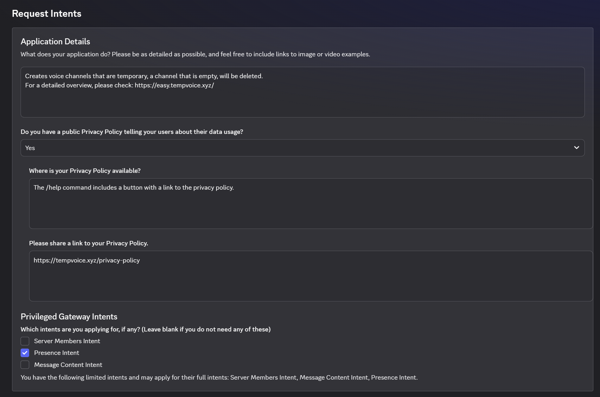

# How do I use TempVoice Premium™?

## Which plan do I need?

| Benefit                                                                                                                                                                      | TempVoice Premium | Your Own Instance |
| ---------------------------------------------------------------------------------------------------------------------------------------------------------------------------- | :---------------: | :---------------: |
| [Custom Appearance](../settings/server/appearance.md) and [Custom Interfaces](../settings/server/interface.md#design)                                                        |         ✓         |         ✓         |
| No vote-locked [commands](../commands/voice/)                                                                                                                                |         ✓         |         ✓         |
| Unlimited [Creator Channels](../settings/server/creators.md) and [Fallback Categories](../settings/overview/category.md#fallbacks)                                           |         ✓         |         ✓         |
| [Moderation Log](../settings/moderation/log.md), [Temporary Voice Role](../settings/others/voice-role.md) and [Interface for In-Voice Chat](../settings/others/interface.md) |         ✓         |         ✓         |
| Your own separately hosted bot with dedicated limits                                                                                                                         |                   |         ✓         |
| [Activity Placeholders](placeholders/activity_name.md) and [Temporary Channel Pooling](../settings/advanced/pooling.md)                                                      |                   |         ✓         |

## Setup

No matter which Premium plan you subscribe to, if you purchased it on the **TempVoice website** (rather than through Discord), you'll need to **activate Premium** on the server where you want to use its benefits. Premium purchased through Discord applies to its server directly and doesn't include Your Own Instance.



### Activate Premium <a href="#activate-premium" id="activate-premium"></a>

Go to [tempvoice.xyz/premium](https://tempvoice.xyz/premium), log in with your Discord account if you're not already logged in, and select your server from the dropdown menu. A subscription covers between 1 and 3 servers, depending on the number of servers you chose.

<figure><figcaption></figcaption></figure>

Make sure you click "Save Changes" afterwards.

<figure><figcaption></figcaption></figure>



### Your Own Instance <a href="#your-own-instance" id="your-own-instance"></a>

If you subscribed to the **Your Own Instance** premium plan, you get your own instance of TempVoice, which lets you customize the username, icon, banner, about me and status of the bot.

Furthermore, your bot has access to all premium benefits plus exclusive features, like the [Activity Placeholders](placeholders/activity_name.md) and [Temporary Channel Pooling](../settings/advanced/pooling.md).

### Setup your bot

To get started, you have to provide us a Discord bot token (see **How to get a Bot Token?** below) to start the installation. This process takes approximately 2 minutes.

#### Bot Token <a href="#token" id="token"></a>

<details>

<summary>How to get a <strong>Bot Token</strong>?</summary>

Don't worry, it won't get too technical.

Visit [https://discord.com/developers/applications](https://discord.com/developers/applications), login with your Discord account and click on **New Application**.

<figure><figcaption></figcaption></figure>

Go to the **Bot** tab, scroll down to **Authorization Flow** and enable **Presence Intent**. The installation fails without it.

Optionally you can turn off **Public Bot**, but <mark style="color:$primary;">don't</mark> turn on **Requires OAuth2 Code Grant**, because the installation fails with it.

<figure><figcaption></figcaption></figure>

Scroll up and click on **Reset Token.** You can change the profile of your bot on the [Premium page](https://tempvoice.xyz/premium) later.

<figure><figcaption></figcaption></figure>


Treat this token like a password, do not share it with anybody.


</details>

<figure><figcaption></figcaption></figure>

Once it has finished, use the `Add to your server` button to invite your bot to your server. Make sure Premium is activated first, otherwise your bot leaves the server again.

### Customize your bot

On the [Premium page](https://tempvoice.xyz/premium), click on the avatar or banner to upload a new image, and edit the name, status and about me of your bot.

* Images can be PNG, JPEG, GIF or WebP files smaller than 8 MB.
* Discord only allows changing the name twice per hour.
* Updating the status can take up to 5 minutes.

To change the profile of your bot for a single Discord server, use [TempVoice Appearance](../settings/server/appearance.md).


**Have you used the public TempVoice bot before?**

The public TempVoice bot has to be kicked from the server on which you invited your bot.

All **Creator Channels** you had with the public TempVoice bot will continue to work. Just the interfaces have to be recreated using `/setup` -> `New Interface`.


### Does your Discord server have more than 10,000 members? <a href="#privileged-intents" id="privileged-intents"></a>

If you are using your bot in a Discord server with **more than 10,000 members**, then you might be informed by Discord that you need to apply to **Privileged Intents**.

<details>

<summary>How to apply for <strong>Privileged Intents?</strong></summary>

Visit [https://discord.com/developers/applications](https://discord.com/developers/applications), login with your Discord account and go to your application.

If you see a banner like below, click the **Apply** button and fill out the asked information.

<figure><figcaption></figcaption></figure>

Simply copy-paste all answers from here:

### Application Details

<figure><figcaption></figcaption></figure>

```
Creates voice channels that are temporary, a channel that is empty, will be deleted.
For a detailed overview, please check: https://easy.tempvoice.xyz/
```

Do you have a public Privacy Policy telling your users about their data usage?

```
Yes
```

Where is your Privacy Policy available?

```
The /help command includes a button with a link to the privacy policy.
```

Please share a link to your Privacy Policy.

```
https://tempvoice.xyz/privacy-policy
```

Privileged Gateway Intents

```
[ ] Server Members Intent
[X] Presence Intent
[ ] Message Content Intent
```

### Presence Intent

<figure><figcaption></figcaption></figure>

Why do you need the Guild Presences intent?

```
Displaying the current playing game/activity of a user in the voice channel name.
```

Please provide links to screenshots and/or videos that demonstrate your use case

```
https://ibb.co/qLNSsThD
```

Can users opt-out of having their Presence data tracked?

```
Yes
```

Are you storing user activity data off-platform (outside of Discord)?

```
Yes
```

Are you storing user activity data for 30 days or less?

```
No
```

How do users contact you to request deletion of their activity data?

```
Users can request their data to be deleted via email to contact@tempvoice.xyz or on the support server https://discord.gg/tempvoice
```

Are you encrypting the data that you store at rest, as is required by our developer policy?

```
Yes
```

</details>



## Manage your subscription <a href="#manage" id="manage"></a>

On the [Premium page](https://tempvoice.xyz/premium), you can:

* **Upgrade to Your Own Instance.** The difference is prorated and added to your next invoice. Your billing cycle doesn't change.
* **Manage your payments** and cancel your subscription at any time.
* **Withdraw from your contract** within 14 days of starting your subscription. Your subscription is cancelled immediately, your last payment is refunded and your premium benefits are removed.

## What happens when Premium ends? <a href="#expired" id="expired"></a>

* Creator Channels above the [free limit](../faq/limits.md#tempvoice) stop working until you reactivate Premium or delete enough of them.
* New interfaces use the default design. Older interfaces that were sent through a webhook stop working until you send a new one with [/setup](../commands/setup.md) -> `New Interface`.
* The Moderation Log and Fallback Categories stop working.
* The Temporary Voice Role and Interface for In-Voice Chat stop working, except on Creator Channels created before December 1, 2025.


By providing your bot token, you confirm that you've read our [Privacy Policy](https://tempvoice.xyz/privacy-policy) & [Terms of Service](https://tempvoice.xyz/terms-of-service) (section 3d) and authorize us to host a TempVoice™ instance on your behalf.


